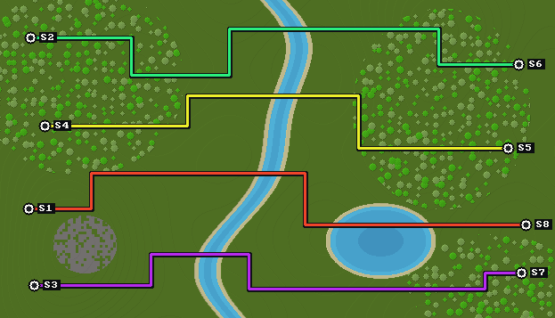

# Oakline

**Map Minecraft railways over the world above them.**


[](LICENSE)

Oakline is a Rust command-line tool that turns a Minecraft Java Edition save
into a railway map. It follows powered rails on a chosen support block
(oak planks by default), includes connected ordinary rails through curves, and
draws each lane in a distinct color over a shaded surface render.

Run it once, get a PNG and station coordinates. The world is read without
modification.

## Preview



*Generated demonstration world · four lanes · eight stations · one pixel per
block. This example is rendered by Oakline from synthetic Java region files.*

## Contents

- [Features](#features)
- [Quick start](#quick-start)
- [Usage and options](#usage-and-options)
- [Track detection](#track-detection)
- [Reading the map](#reading-the-map)
- [Compatibility and limitations](#compatibility-and-limitations)
- [Troubleshooting](#troubleshooting)
- [Development](#development)
- [Acknowledgments and license](#acknowledgments-and-license)

## Features

- **Railway discovery:** active powered rails directly above selected support
  blocks identify the network. Oak planks are the default.
- **Curves and slopes:** connected ordinary rails fill short sections between
  markers, following the saved rail shapes and elevations.
- **Distinct lane colors:** each traced lane receives a unique RGB color, with
  a dark outline for visibility over the terrain.
- **Station markers:** track endpoints are labeled `S1`, `S2`, and so on;
  their X/Y/Z coordinates are printed in the terminal.
- **Surface context:** block colors, terrain shading, and water-depth bands
  show where underground routes run.
- **Automatic scaling:** the output preserves one pixel per block when it fits,
  then uses integer reduction for larger networks.
- **Parallel processing:** region scanning and surface rendering use multiple
  CPU cores.
- **Modern save handling:** gzip, zlib, raw, and Java LZ4 chunks are supported,
  including external `.mcc` files.

## Quick start

You need Rust **1.88 or newer**, Cargo, and an extracted Minecraft Java Edition
world save. Development and validation currently use Rust 1.98.1 on Linux.

From the repository root:

```bash
cargo build --release --locked

./target/release/oakline "/path/to/.minecraft/saves/My World" \
  --output oakline.png
```

You can also build and run through Cargo:

```bash
cargo run --release --locked -- "/path/to/world" --output oakline.png
```

Point Oakline at the **world directory**, which contains a `region/` folder:

```text
My World/
├── level.dat
├── region/
│   ├── r.0.0.mca
│   ├── r.-1.0.mca
│   └── ...
└── ...
```

Close Minecraft or stop the server before scanning so its latest changes are
saved. Rail power is read from the saved block state.

## Usage and options

```text
oakline [OPTIONS] [SAVE]
```

| Argument or option | Default | Purpose |
| --- | --- | --- |
| `<SAVE>` | Required for rendering | World directory containing `region/`; optional with `--list-blocks`. |
| `-o, --output <PATH>` | `oakline.png` | Destination PNG; use a `.png` filename. |
| `--support-block <BLOCK>` | `minecraft:oak_planks` | Block directly below active powered rails; repeat the flag or comma-separate several IDs. |
| `--list-blocks` | — | Print all supported block IDs from `blocks.json`, then exit. |
| `--gap <BLOCKS>` | `16` | Maximum connected ordinary-rail distance from a powered marker; `0–256`. |
| `--padding <BLOCKS>` | `128` | Surface margin around the detected network; zero or greater. |
| `--max-size <PIXELS>` | `8192` | Maximum output width or height; at least `256`. |
| `--line-width <PIXELS>` | `3` | Colored lane width in the final image; `1–16`. |
| `-h, --help` | — | Show usage information. |
| `-V, --version` | — | Show the installed version. |

The save path and output path are separate arguments. Running `oakline` without
a save, or passing `oakline.png` as the save, prints **“no save was given”**.
Use `--output oakline.png` alongside a world directory.

### Choose another support block

```bash
cargo run --release --locked -- "/path/to/world" \
  --support-block stone --output stone-network.png
```

Short names such as `stone` and full IDs such as `minecraft:stone` are both
accepted. Specifying a support block replaces the oak-plank default. To accept
several foundations:

```bash
cargo run --release --locked -- "/path/to/world" \
  --support-block oak_planks,stone \
  --support-block spruce_planks --output combined-network.png
```

List every supported choice without scanning a save:

```bash
cargo run --release --locked -- --list-blocks
```

The list and argument validation use all block IDs in the bundled
[blocks.json](blocks.json). Unknown IDs are rejected before scanning.

### Include longer ordinary-rail sections

```bash
cargo run --release --locked -- "/path/to/world" \
  --gap 32 --output network.png
```

### Keep a compact map with stronger route lines

```bash
cargo run --release --locked -- "/path/to/world" \
  --padding 64 --max-size 4096 --line-width 5 --output overview.png
```

### Preserve more surface detail for a large network

```bash
cargo run --release --locked -- "/path/to/world" \
  --max-size 12288 --output detailed.png
```

Increasing `--max-size` allows more detail and uses more image memory. The PNG
pixel buffer is limited to **512 MiB**; terrain data and the railway graph
also consume memory.

## Track detection

Oakline uses the construction of the railway to distinguish it from other
rails in the save.

1. **Find markers.** A marker must be `minecraft:powered_rail` with the saved
   property `powered=true`, directly above one of the selected
   `--support-block` IDs. The default is `minecraft:oak_planks`.
2. **Follow existing track.** Matching rail exits form connections. Ordinary
   `minecraft:rail` blocks are included within the configured gap distance,
   including corner blocks. Ascending shapes connect only at the correct
   height.
3. **Trace lanes and stations.** Physical track endpoints become stations.
   Paths between endpoints receive separate colors. Junctions split paths into
   colored segments, and closed loops are drawn without an invented station.

`--gap` is measured from the **nearest marker along the track**, rather than
as a straight-line distance across the map. Markers at both ends can cover a
run of up to twice the configured number of ordinary rails.

The tool includes rails that already exist in the save. It does not create
track across missing blocks or modify the railway. If the gap limit cuts off
a path, that artificial boundary is drawn without a station label.

## Reading the map

- **North is up**: negative Z is at the top; positive X points east, to the
  right.
- **Colored lines are railway lanes**: their position is projected onto the
  surface, regardless of track depth.
- **White station symbols and `S#` labels mark endpoints**: the corresponding
  coordinates appear in the terminal.
- **Dark background indicates missing or unexplored chunks**.
- **The frame follows the railway**: the map covers the detected network and
  its padding, rather than the entire explored world.

A small example of the coordinate listing:

```text
S1: x=-512, y=-43, z=264
S2: x=1535, y=-43, z=264
```

Labels try alternate positions to avoid markers and other labels. The surface
uses block colors and shading; unknown blocks receive a consistent muted
fallback color.

## Compatibility and limitations

| Area | Current behavior |
| --- | --- |
| Minecraft edition | Java Edition saves. Bedrock saves are unsupported. |
| Save layout | Modern Anvil block palettes, using the Java 1.18+ section layout. Legacy formats are unsupported. |
| Minecraft 26.3 | Intended target; |
| Dimension | The Overworld, read from the supplied world's `region/` directory. |
| Operating system | Validated on Linux. Windows and macOS have not been tested. |
| Surface style | Block colors and height shading; resource-pack textures and biome-specific tints are unsupported. |
| Station naming | Generated `S#` IDs. Signs and station names are not read. |

Further limits to keep in mind:

- Tracks qualify by their **rail state and selected foundation**. An aboveground
  railway built with the same markers is included too.
- Inactive powered rails, powered rails on an unselected foundation, detector
  rails, and activator rails are excluded. Those blocks can interrupt a route.
- Stations are inferred from track ends. Broken track can resemble a station;
  nearby platform ends are not grouped into one station.
- Vertically separated routes remain distinct in the graph but can overlap in
  a top-down image. At reduced scales, nearby lanes may occupy the same pixels.
- Exceptionally crowded maps can run out of space for separate station labels.
- Invalid chunks are reported and skipped, which can leave the network
  incomplete. Compressed and decoded chunk data are capped at **64 MiB**.
- All region files are scanned before cropping. `--max-size` limits image
  dimensions, not the memory used to scan a large world.

## Troubleshooting

| Symptom | What to check |
| --- | --- |
| “No save was given” | Pass a world directory. A PNG belongs after `--output`; `--list-blocks` works without a save. |
| “The region directory is missing” | Pass the world directory, not `level.dat`, an individual `.mca`, or the `region/` directory itself. |
| No active powered rails on the selected support blocks | Check the saved power state and the block directly below the rail. Choose its ID with `--support-block` and save while the rails are powered. |
| A support block is rejected | Run `--list-blocks` to see every ID from `blocks.json`. Short Minecraft names and namespaced IDs are accepted. |
| A curve or ordinary-rail section is cut off | Increase `--gap`, then check that the route contains connected ordinary rails. |
| A route stops at a powered rail | Check that the rail is active and directly above a selected support block. Increasing `--gap` does not admit an excluded powered rail. |
| Chunk read warnings appear | Check that the save has finished writing and that referenced external `.mcc` files are present. |
| The image exceeds its allocation limit | Reduce `--max-size` or `--padding`. |
| Nearby routes are hard to distinguish | Increase `--max-size` to retain more detail, or reduce `--line-width`. |

## Development

Run the existing checks:

```bash
cargo fmt --check
cargo test --locked
cargo clippy --locked --all-targets -- -D warnings
```

Tests cover missing-save messages, catalog validation, selected support blocks,
rail shapes and slopes, ordinary-rail curves, search boundaries,
lane-color collisions, negative coordinates, padded palettes, external chunks,
malformed data, stroke widths, label placement, and an Anvil/NBT-to-PNG
round trip.

### Source layout

| File | Responsibility |
| --- | --- |
| [src/main.rs](src/main.rs) | CLI options, scan orchestration, cropping, and PNG output. |
| [src/blocks.rs](src/blocks.rs) | Shared JSON block catalog, ID validation, and sorted block listing. |
| [src/world.rs](src/world.rs) | Region reading, decompression, NBT palettes, surface extraction, and rail detection. |
| [src/graph.rs](src/graph.rs) | Rail connections, bounded expansion, stations, lane tracing, and colors. |
| [src/render.rs](src/render.rs) | Surface shading, scale selection, lane strokes, and station labels. |
| [src/model.rs](src/model.rs) | Shared rail, graph, surface, and bounds types. |
| [blocks.json](blocks.json) | Bundled surface block-color palette. |

### Performance

The implementation caches region headers and section palette metadata, reuses
graph allocations, tracks visited edges with packed bits, and renders terrain
rows in parallel.

Local measurements on **generated saves**:

| Workload | Before optimization | After optimization |
| --- | ---: | ---: |
| 16,384 chunks with uniform palettes | 0.200 s | 0.054–0.079 s |
| 16,384 chunks with mixed 17-entry palettes | 0.208 s | 0.092–0.106 s |
| Graph processing for 200,000 rails | 285–298 ms | 88–102 ms |

The generated-save runs used about 30 MiB of peak memory after optimization.
These are local synthetic measurements, not a performance guarantee.
Hardware, filesystem caching, compression, save size, and railway layout affect
runtime. The benchmark harness is not currently part of the repository.

If you contribute a parsing or topology fix, include a small reproducible
fixture or a focused regression test. Use the checks above before submitting
a change.

## Acknowledgments and license

Oakline's surface-rendering approach and block-color palette are adapted from
[Dynamic Minecraft Mapping Tool (DMMT)](https://github.com/TizioKayoso/DMMT)
by TizioKayoso. DMMT provided the foundation for parallel region processing,
top-down surface selection, depth-banded water, and crisp map scaling.

Oakline adds railway discovery, graph reconstruction, endpoint detection,
per-lane colors, and a single-image command-line workflow. It uses
`lz4-java-wrc` for Java LZ4 decoding and `fastanvil` in tests to generate
independent Anvil fixtures.

Licensed under **GNU GPL-3.0-only**. See [LICENSE](LICENSE) for the full terms and
[NOTICE](NOTICE) for attribution.
